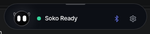

<div align="center">


# Soko (そ小)

### *Dynamic Island Desktop HUD & High-Speed Android Companion*

[](https://github.com/Saurabh-singhx/soko/releases)
[](https://github.com/Saurabh-singhx/soko/releases)
[](LICENSE)
[](https://github.com/Saurabh-singhx/soko)

<p align="center">
  <b>Zero-Cloud Local Workstation Integration</b><br>
  Reactive OLED Mascot HUD • High-Speed Hotspot File Transfers (60 MB/s) • Real-Time Notification Mirroring • Remote CLI Agent Terminal • Desktop Audio Streaming
</p>

[✨ Key Features](#-features) • [📥 Downloads](#-downloads) • [🏗️ Architecture](#-system-architecture) • [🚀 Quick Start](#-quick-start) • [🛡️ Security](#-security--zero-trust) • [📖 Documentation](#-deep-dive-documentation)

<br/>



</div>

---

## 💡 What is Soko?

**Soko** transforms your desktop (Linux & Windows) and Android device into a synchronized, zero-latency workstation. 

Unlike proprietary cloud bridges or heavy screen-mirroring tools, Soko operates **100% locally** over peer-to-peer Wi-Fi LAN, Hotspot, and Bluetooth Low Energy. It pairs a sleek, floating top-center **Dynamic Island HUD** on your desktop with an ultra-responsive companion app on your phone.

Whether you need to beam 100MB+ APKs and media files across devices in seconds without touching cellular data, keep an eye on real-time smartphone notifications while coding, monitor remote CLI agent workflows, or stream PC audio to your phone, Soko does it all with zero internet dependency and zero cloud surveillance.

---

## ✨ Features

### 🏝️ Dynamic Island Desktop HUD
- **Top-Center Floating Island**: Frameless, transparent, and spring-physics animated desktop HUD styled with Linear dark glassmorphic aesthetics.
- **Click-Through & Screen Adaptive**: Seamlessly floats above your IDE and active windows without blocking your cursor or screen content. Dismisses on `Escape` or outside click.
- **Multi-State Fluid Layout**: Expands smoothly when notifications arrive, file transfers initiate, or CLI commands stream output.

### 🤖 Living Soko Bot Mascot
- **OLED Micro-Avatar**: High-framerate animated cyber-mascot living inside the island.
- **Biomimetic Eye Engine**: Dynamic eye-tracking, biological ballistic saccades, blink reflexes, and expressively choreographed emotions (`idle`, `happy`, `thinking`, `busy`, `error`, `surprised`).
- **360° Physics Interactions**: Watch Soko roll, inspect active transfers, read incoming messages left-to-right, and react to system state changes.

### 🎭 Modular Character Engine & Custom AI Imports
- **Universal Character Host**: Hot-swap between built-in mascots (**Grok Bot**, **Cyber Cat**) or import custom character packs generated via AI.
- **Strict Validation Guardrails**: Automatically verifies essential states (`idle`, `thinking`, `music`) to guarantee UI animations never break.
- **Atmospheric Island Backgrounds**: Characters dynamically customize the Dynamic Island's background gradient and color palette for every state (`dragging`, `hover`, `git_push`, `git_commit`, `charging`, `online`, `offline`, `music`, `thinking`, `idle`).
- **Dynamic Eye Color & Halo Bloom**: Dynamic color synchronization (`#EF4444` alerts, `#A855F7` git push, `#2DD4BF` git commit, `#FBBF24` charging, `#FB923C` dragging, `#6366F1` multi-session) with an ambient backlight glow halo.
- **Complete Architecture & AI Generator**: See [docs/characters/README.md](docs/characters/README.md) for full technical schemas, SVG specs, and ready-to-use AI prompts.

### ⚡ 60 MB/s Hotspot & LAN Transfers
- **Direct Peer-to-Peer Streaming**: Pull and push files directly between devices at 30–60+ MB/s over local Wi-Fi or Mobile Hotspot.
- **Zero Cellular Data**: Transfers bypass external networks completely—beam heavy build artifacts, videos, and APKs in under 2 seconds.
- **Native Android DownloadManager**: Received files are automatically verified via SHA-256 and integrated into Android's native Downloads manager and Desktop file manager.

### 🔔 Real-Time Notification Mirroring
- **Native Android NotificationListener**: Low-latency event streaming delivers notifications right to your desktop Island HUD.
- **Authentic Brand Squircle Badges**: Pixel-perfect app icons for WhatsApp, Telegram, Slack, Discord, GitHub, Gmail, SMS, and custom applications.
- **Expandable Card Reader & 1-Click Copy**: Expand notifications on hover or click to inspect multi-line content, and click any message to instantly copy text to your desktop clipboard.

### 💻 Remote Developer CLI Agent Deck
- **Mobile Control Terminal**: Trigger, inspect, and monitor local command-line tasks (such as `antigravity-cli` / `agy`, Git status, or custom shell operations) straight from your phone.
- **Live Streaming stdout**: Real-time ANSI terminal logs stream over WebSockets to your mobile companion deck.
- **Whitelisted Sandbox**: Only commands explicitly registered in the desktop configuration can be executed, preventing arbitrary remote code execution (RCE).

### 🎵 Low-Latency Desktop Audio Streaming (Option 1 HTTP Stream)
- **Zero-Bloat Desktop-to-Phone Audio**: Stream desktop sound (YouTube, Spotify, IDE build alerts, movies) directly to your mobile device or Bluetooth earbuds without adding a single megabyte to your APK.
- **Why Option 1 Beats WebRTC**: Bypasses WebRTC's 15–30 MB `libwebrtc` binary penalty, eliminates 1.5–3s cold-start SDP/ICE delays, and avoids speech filters (AEC/AGC) that degrade music fidelity.
- **High-Fidelity 192 kbps Stereo**: Crystal-clear 48 kHz stereo streaming via PipeWire / PulseAudio on Linux and WASAPI Loopback on Windows.
- **Android Lock-Screen & Background Playback**: Native media session integration keeps sound streaming seamlessly even when your phone is locked in your pocket.
- **Instant Connect & Zero-Idle CPU**: Connects in <100ms; automatically spawns the low-delay encoder upon connection and frees OS audio loopbacks when listeners disconnect.

### 📱 Mobile Companion & Silent Link Daemon
- **Lean, Non-Intrusive Daemon**: Lightweight native background service (`SokoBackgroundService`) keeps local LAN and Hotspot links alive without notification shade spam.
- **Zero-Cloud Local Privacy**: 100% offline peer-to-peer data synchronization with zero third-party cloud intermediaries.
- **Desktop Dynamic Island Focus**: Live alerts, audio waveforms, and file progress are centralized on the Desktop HUD, avoiding mobile screen overlay clutter and touch dead zones.

### 🛡️ Zero-Trust Security & Pairing
- **Short Authentication String (SAS)**: Cryptographic 6-digit confirmation codes guarantee physical human-in-the-loop pairing.
- **Replay Attack Defense**: Monotonic sequence counters reject duplicated or delayed network packets.
- **Sandboxed File Ingestion**: Strict basename sanitization prevents directory-traversal attacks (`../`) and enforces `0644` non-executable permissions.

---

## 📥 Downloads

Ready-to-use binaries are published with every release on [GitHub Releases](https://github.com/Saurabh-singhx/soko/releases).

| Platform | Package Format | Direct Download / Install Command | Notes |
| :--- | :--- | :--- | :--- |
| **Linux (x64)** | `.AppImage` | [`soko-linux-x86_64.AppImage`](https://github.com/Saurabh-singhx/soko/releases/latest) | Portable, runs on any modern distro (Ubuntu, Fedora, Arch) |
| **Linux (x64)** | `.deb` | [`soko-linux-amd64.deb`](https://github.com/Saurabh-singhx/soko/releases/latest) | Debian, Ubuntu, Linux Mint native package |
| **Linux (x64)** | `.tar.gz` | [`soko-linux-x64.tar.gz`](https://github.com/Saurabh-singhx/soko/releases/latest) | Standalone unpacked binary archive |
| **Windows (x64)** | Portable `.exe` | [`soko-win-x64.exe`](https://github.com/Saurabh-singhx/soko/releases/latest) | Standalone portable executable (No installer required) |
| **Windows (x64)** | `.zip` | [`soko-win-x64.zip`](https://github.com/Saurabh-singhx/soko/releases/latest) | Unpack and launch `soko.exe` |
| **Android (API 24+)** | `soko-mobile.apk` | [`soko-mobile.apk`](https://github.com/Saurabh-singhx/soko/releases/latest) | Full companion with silent link daemon, notification listener, & audio streaming |
| **Android (API 24+)** | `soko-mobile-lite.apk` | [`soko-mobile-lite.apk`](https://github.com/Saurabh-singhx/soko/releases/latest) | Lite standalone companion (Clean transfer & CLI, 0 Play Protect warnings) |

> [!TIP]
> On Linux, you can also launch the application via `./run-desktop.sh` after building locally.

---

## 🏗️ System Architecture

```
┌────────────────────────────────────────────────────────┐
│                   Desktop Workstation                  │
│                                                        │
│  ┌────────────────────────┐  ┌───────────────────────┐ │
│  │   Dynamic Island HUD   │  │   Settings & Controls │ │
│  │   (Electron + React)   │  │   (Linear Dark Theme) │ │
│  └───────────┬────────────┘  └───────────┬───────────┘ │
│              │                           │             │
│              ▼                           ▼             │
│  ┌──────────────────────────────────────────────────┐  │
│  │     Soko Local Bridge Daemon (Node.js / :8766)   │  │
│  │  • WebSocket Duplex Conduit                      │  │
│  │  • PipeWire / PulseAudio Real-Time Streamer      │  │
│  │  • Whitelisted CLI PTY Process Spawner          │  │
│  │  • High-Speed HTTP Chunked Transfer Receiver     │  │
│  └────────────────────────┬─────────────────────────┘  │
└───────────────────────────┼────────────────────────────┘
                            │
              Local Wi-Fi LAN / Mobile Hotspot
         Dual-Protocol: WebSocket (Control) + HTTP (Data)
                            │
┌───────────────────────────┼────────────────────────────┐
│                           ▼                            │
│  ┌──────────────────────────────────────────────────┐  │
│  │          Soko Android Companion Device           │  │
│  │                                                  │  │
│  │  • Native Android NotificationListenerService    │  │
│  │  • High-Speed Hotspot Downloader (30-60 MB/s)    │  │
│  │  • Remote CLI Command Deck & Real-time Console   │  │
│  │  • Low-Latency Mobile Audio Player               │  │
│  └──────────────────────────────────────────────────┘  │
│                   Android Smartphone                   │
└────────────────────────────────────────────────────────┘
```

Detailed architectural diagrams, protocols, and threat models can be reviewed in [docs/ARCHITECTURE.md](docs/ARCHITECTURE.md).

---

## 🚀 Quick Start

### Prerequisites
- **Node.js**: v18.0.0 or higher
- **npm**: v9.0.0 or higher
- **Linux (optional)**: `libgtk-3-dev`, `libnotify-dev`, `alsa-utils` / `pipewire`
- **Android**: Android 7.0 (Nougat, API 24) or newer

### 1. Clone the Repository
```bash
git clone https://github.com/Saurabh-singhx/soko.git
cd soko
```

### 2. Install Dependencies
```bash
npm install
npm --prefix apps/desktop install
```

### 3. Run the Desktop App (Development)
```bash
# Launch the local connection bridge daemon
npm run bridge

# In a separate terminal, launch the desktop HUD
npm run dev:desktop
```

Or run the complete packaged desktop build directly on Linux:
```bash
./run-desktop.sh
```

### 4. Connect Your Android Device
1. Install **`soko-mobile.apk`** on your Android device (or open `http://<YOUR_DESKTOP_IP>:8766` in your mobile browser).
2. Enter the **6-digit SAS PIN** displayed in your desktop Settings window.
3. Once paired, notifications, high-speed file transfers, and remote CLI tools are instantly live!

---

## 🛠️ Building From Source

### Building Desktop Packages (Linux & Windows)
Soko uses Electron Builder to package distribution binaries:

```bash
# Compile desktop frontend
npm run build:desktop

# Package Linux targets (.AppImage, .deb, .tar.gz)
npm run build:linux

# Package Windows targets (Portable .exe, .zip)
npm run build:windows

# Package all desktop targets simultaneously
npm run build:desktop:all
```
Generated artifacts will be placed in the `dist-desktop/` directory.

### Building Android APKs
Soko features an automated standalone Android build pipeline utilizing `aapt2`, `d8`, `zipalign`, and `apksigner`:

```bash
npm run build:apk
```
This generates:
- `apks/soko-mobile.apk`: Full companion with Android Notification Listener
- `apks/soko-mobile-lite.apk`: Lightweight companion with zero permission requirements
- `apks/soko-desktop.apk`: Dynamic Island HUD testbed compiled for Android displays

---

## 🔄 Continuous Builds & Gist Auto-Updates

Soko uses continuous build versioning and an atomic GitHub Gist feed for zero-rate-limit auto-updates.

### 1. Monotonic Build Versioning
- **Automatic Version Increments**: Every build pushed to `master`/`main` or triggered via GitHub Actions automatically bumps the build version (`1.0.<run_number>`), keeping desktop and mobile packages synchronized.
- **Manual Tags**: Pushing a tag (`git tag v1.0.5 && git push origin v1.0.5`) automatically releases that explicit version.

### 2. Setting Up the Gist Secret for Auto-Updates
To allow GitHub Actions to automatically update the client version feed on every build:

1. **Create a GitHub Token**: Go to [GitHub Settings > Developer Settings > Personal Access Tokens (Classic)](https://github.com/settings/tokens) and generate a token with the **`gist`** scope.
2. **Add Secret to Repository**:
   - Go to your repo: **Settings > Secrets and variables > Actions > New repository secret**.
   - Name: `GIST_SECRET`
   - Value: paste your GitHub Token.
3. *(Optional)* **Set GIST_ID**: If you already created a Gist for Soko, add `GIST_ID` as a repository secret or variable. If omitted, the workflow will automatically create one on the first run and output its ID in the build logs!

Desktop clients can configure their raw Gist feed URL directly in **Settings > Auto-Updates & Feed** to enjoy instantaneous update alerts and 1-click downloads.

---

## 🧪 Testing

Soko includes a comprehensive end-to-end integration test suite verifying health telemetry, notification dispatch, remote CLI whitelist enforcement, path traversal protection, and SHA-256 upload verification:

```bash
# Start bridge and execute full test suite
node scripts/soko_bridge.js &
PID=$!
npm test
kill $PID
```

---

## 🛡️ Security & Zero-Trust

Soko is engineered under a strict **Zero-Trust Local Network** security model:

1. **Whitelisted CLI Execution Only**: Soko rejects arbitrary command execution. Only pre-configured aliases registered in the desktop configuration (e.g., `sysinfo`, `git-status`, `antigravity`) can be executed. Attempts to execute unauthorized commands or shell injections (`rm -rf`, `;`, `&&`) are blocked with HTTP `403 Forbidden`.
2. **Path Sanitization & Sandbox**: All received files are stripped of directory paths (`../`) to their strict basename and stored inside a sandboxed `transfers/` directory with non-executable permissions (`0644`).
3. **Cryptographic Checksum Verification**: Transferred files compute and verify SHA-256 hashes on the fly. Corrupted or tampered files are purged immediately.
4. **Physical SAS Confirmation PIN**: Initial pairing requires manual entry of a 6-digit confirmation PIN displayed on the desktop HUD, guarding against rogue devices on shared Wi-Fi networks.

---

## 📖 Deep-Dive Documentation

Explore our comprehensive engineering logs and feature architecture documents:

| Topic | Document |
| :--- | :--- |
| **Global Architecture & Threat Model** | [docs/ARCHITECTURE.md](docs/ARCHITECTURE.md) |
| **Dynamic Island HUD & X11/Wayland Physics** | [docs/features/01-dynamic-island-hud.md](docs/features/01-dynamic-island-hud.md) |
| **Bluetooth Low Energy vs Classic RFCOMM** | [docs/features/02-bluetooth-dual-protocol.md](docs/features/02-bluetooth-dual-protocol.md) |
| **Hotspot & LAN Zero-Cellular High-Speed Transfers** | [docs/features/03-hotspot-high-speed-transfer.md](docs/features/03-hotspot-high-speed-transfer.md) |
| **Remote CLI Agent Runner & PTY Security** | [docs/features/04-remote-cli-execution.md](docs/features/04-remote-cli-execution.md) |
| **Android NotificationListener Service & Filters** | [docs/features/05-notification-mirroring.md](docs/features/05-notification-mirroring.md) |
| **Zero-Trust SAS Pairing & Replay Guards** | [docs/features/06-security-and-pairing.md](docs/features/06-security-and-pairing.md) |
| **Grok Bot Living OLED Mascot Animation Engine** | [docs/features/07-grok-bot-monochrome-animation.md](docs/features/07-grok-bot-monochrome-animation.md) |
| **Low-Latency Desktop Audio Streaming (Option 1 HTTP Stream)** | [docs/features/08-desktop-audio-streaming.md](docs/features/08-desktop-audio-streaming.md) |
| **Mobile Dynamic Island & Fluid Cloud Technical Analysis** | [docs/features/09-mobile-dynamic-island-fluid-cloud.md](docs/features/09-mobile-dynamic-island-fluid-cloud.md) |
| **YouTube Music Offline Desktop Connector** | [docs/features/10-youtube-music-offline-connector.md](docs/features/10-youtube-music-offline-connector.md) |
| **Custom Character Creation Guide & AI Prompt (Mascots & Atmospheric Backgrounds)** | [docs/characters/README.md](docs/characters/README.md) |

---

## 🤝 Contributing

Contributions, bug reports, and suggestions are warmly welcomed!

1. Fork the repository
2. Create your feature branch (`git checkout -b feat/amazing-feature`)
3. Commit your changes (`git commit -m 'feat: add amazing feature'`)
4. Push to the branch (`git push origin feat/amazing-feature`)
5. Open a Pull Request

---

## 📄 License

Distributed under the **MIT License**. See [`LICENSE`](LICENSE) for more details.

---

<div align="center">
  <sub>Crafted with passion for a unified desktop and mobile developer workflow.</sub>
</div>
