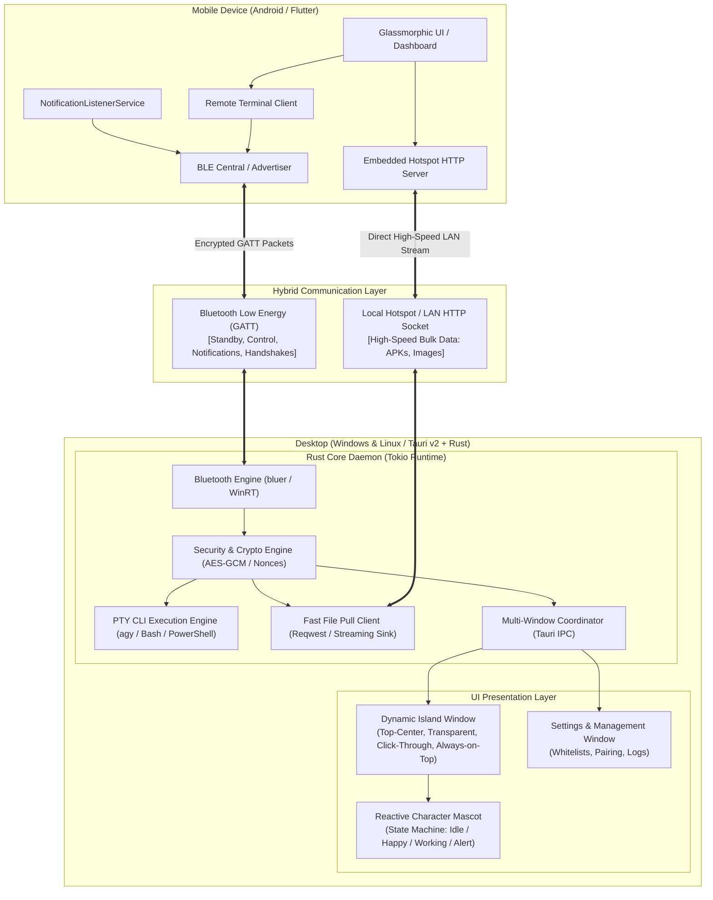

# Soko System Architecture

> **Soko** is a seamless cross-platform device companion uniting desktop systems (Linux & Windows) with mobile devices (Android) through an Apple-inspired Dynamic Island HUD, real-time Bluetooth Low Energy (BLE) control, high-speed Hotspot/LAN data conduits, and a remote terminal command runner.

---

## 1. High-Level Vision & Design Goals

1. **Unobtrusive Presence (Dynamic Island HUD)**: Instead of bulky notification trays or standard modal dialogs, Soko introduces a floating, pill-shaped HUD positioned top-center on the desktop display. It morphs fluidly between a minimal, playful mascot state and expanded action cards (incoming notifications, running CLI agent output, file progress).
2. **Dual-Channel Connectivity**:
   - **Signaling Channel (BLE)**: Zero-friction pairing, continuous presence detection, micro-packet notifications, remote CLI triggers, and biometric approval tokens.
   - **Bulk Data Channel (Hotspot/Local Wi-Fi)**: Zero-configuration high-speed peer-to-peer file transfer designed specifically for large files such as APK builds and media assets, delivering 30–60 MB/s without consuming cellular mobile data.
3. **Safe Remote Terminal Execution**: Control desktop command-line agents (such as `antigravity-cli` / `agy`) from mobile without opening dangerous unauthenticated shell vulnerabilities.
4. **Zero-Trust Security**: End-to-end encrypted packet envelopes, replay protection via nonces and sequence numbers, cryptographic confirmation PINs, and sandboxed file reception.

---

## 2. Global Architecture Diagram



---

## 3. Monorepo Repository Structure

The project is structured as a scalable monorepo separating desktop, mobile, shared protocols, and research documentation:

```
soko/
├── apps/
│   ├── desktop/                  # Tauri v2 Desktop Application (Windows & Linux)
│   │   ├── src-tauri/            # Rust Backend Daemon
│   │   │   ├── src/
│   │   │   │   ├── bluetooth/    # BLE client/server & Classic RFCOMM fallback
│   │   │   │   ├── cli/          # Safe PTY command runner & whitelisting
│   │   │   │   ├── transfer/     # High-speed Hotspot file client & sandbox
│   │   │   │   ├── windows/      # Dynamic Island HUD & Settings window management
│   │   │   │   ├── security/     # AES-256-GCM, ECDH key exchange & nonces
│   │   │   │   └── main.rs       # Application bootstrap & Tauri event loop
│   │   │   └── Cargo.toml
│   │   └── src/                  # Desktop Frontend (React + Framer Motion + Tailwind)
│   │       ├── components/
│   │       │   ├── island/       # Dynamic Island HUD, Mascot, Notifications, CLI widgets
│   │       │   └── settings/     # Pairing PINs, Whitelist editor, File settings
│   │       └── App.tsx           # Multi-window view switcher
│   └── mobile/                   # Flutter Mobile Application (Android / iOS)
│       └── lib/
│           ├── core/             # Glassmorphism theme tokens, crypto & protocol types
│           ├── services/         # BLE service, Hotspot HTTP file server, Notification listener
│           └── ui/               # Glassmorphic dashboard, terminal deck, file sender
├── packages/
│   └── protocol/                 # Shared JSON schemas, packet specs & constants
│       └── schema/               # Formal JSON schemas for packets
├── docs/
│   ├── ARCHITECTURE.md           # This document
│   └── features/                 # In-depth technical research & failed attempt logs
│       ├── 01-dynamic-island-hud.md
│       ├── 02-bluetooth-dual-protocol.md
│       ├── 03-hotspot-high-speed-transfer.md
│       ├── 04-remote-cli-execution.md
│       ├── 05-notification-mirroring.md
│       └── 06-security-and-pairing.md
└── README.md
```

---

## 4. Subsystem Details

### 4.1 Desktop: Dynamic Island HUD & Multi-Window Architecture

To achieve the Apple Dynamic Island experience on desktop without interfering with normal user workflow, Tauri v2's multi-window capabilities are leveraged:

1. **Island Window (`dynamic-island`)**:
   - Position: `x: (screen_width - island_width) / 2`, `y: 0`.
   - Attributes: `always_on_top: true`, `decorations: false`, `transparent: true`, `skip_taskbar: true`.
   - **Click-Through / Hit Testing**:
     - When idle (compact pill), mouse events outside the pill border must pass through to whatever window is behind it (`set_ignore_cursor_events(true)` on transparent margins, or dynamically re-sizing the physical OS window dimensions to match the pill).
     - When expanded (user hovers or notification opens), window bounds expand and capture mouse clicks.
2. **Settings Window (`main-settings`)**:
   - A traditional decorative window used for device discovery, PIN entry, setting command whitelists, and monitoring connection health.

### 4.2 Reactive Mascot Character

The island houses a circular mascot avatar that communicates system status visually:
- **Idle**: Gentle breathing cycle, random blinks.
- **Pairing / Connecting**: Looking left/right, radar scan ripples.
- **Notification Received**: Surprise expression, head turns toward incoming text banner.
- **CLI Command Executing**: "Working" expression with a miniature terminal spinner.
- **CLI Succeeded / File Received**: Joyful smile, bounce transition.
- **Error / Rejection**: Confused/shaking head animation.

### 4.3 High-Speed Hotspot / LAN APK File Transfers

Large binaries such as build APKs (30MB–100MB+) cannot be transferred over Bluetooth within acceptable timeframes.

- **The Problem**: Bluetooth LE tops out at ~15 KB/s. Bluetooth Classic RFCOMM tops out at ~150–200 KB/s (5–10 minutes for an APK).
- **The Hotspot Solution**:
  1. The mobile device runs an internal HTTP file server bound to its local IP (e.g., `192.168.43.1` when hosting a hotspot).
  2. The mobile sends a tiny BLE packet containing the download URL and a one-time session token:
     ```json
     {
       "type": "FILE_OFFER",
       "filename": "soko-app-release.apk",
       "size_bytes": 45892012,
       "download_url": "http://192.168.43.1:9090/download?token=8a3f9e2b",
       "sha256": "e3b0c44298fc1c149afbf4c8996fb92427ae41e4649b934ca495991b7852b855"
     }
     ```
  3. The desktop Rust backend receives the packet over BLE, displays the incoming file in the Dynamic Island, and issues a fast multi-threaded HTTP streaming GET request over the local Wi-Fi interface.
  4. **Speed**: 30–60 MB/s. Transfer completes in 1.5 seconds.
  5. **Firewall Invariance**: Because the PC connects *outbound* to the phone's gateway, Windows Defender and Linux `iptables` allow the connection without security alerts.

### 4.4 Safe Remote Terminal & CLI Agent Runner

Controlling developer tools like `antigravity-cli` (`agy`) or custom build scripts from mobile requires strict guardrails:
1. **No Raw Shell Ingestion**: The daemon never passes unsanitized strings to `/bin/sh` or `cmd.exe`.
2. **Whitelist Manifest**:
   ```json
   {
     "allowed_commands": [
       { "id": "agy-status", "bin": "agy", "args": ["status"] },
       { "id": "agy-run", "bin": "agy", "args": ["run"] },
       { "id": "git-pull", "bin": "git", "args": ["pull", "origin", "main"] },
       { "id": "lock-pc", "bin": "loginctl", "args": ["lock-session"] }
     ]
   }
   ```
3. **PTY Virtual Stream**: Output is captured in chunks and sent back to mobile over the BLE channel or buffered in memory for real-time inspection.

---

## 5. Security & Threat Model

| Threat | Mitigation Mechanism |
| :--- | :--- |
| **Bluetooth Sniffing** | All application payload envelopes are encrypted with **AES-256-GCM** using keys negotiated via ECDH (X25519) during initial setup. |
| **Replay Attacks** | Every packet includes a monotonic 64-bit sequence counter and timestamp window. Duplicate or old nonces are dropped immediately. |
| **RCE via Shell Injection** | Strict argv-based execution. No arbitrary command line strings allowed without explicit desktop-side confirmation. |
| **Path Traversal Attacks** | Received files have filenames sanitized against `../`, null bytes, and path delimiters, and are strictly written to a sandboxed directory (`~/Downloads/SokoFiles/`). |
| **Accidental Mobile Triggers** | Sensitive commands require local biometric authentication (Android BiometricPrompt) before transmission. |

---

## 6. Scalability Strategy

- **Module Independence**: The Rust backend divides responsibilities into decoupled Tokio actors (`BluetoothActor`, `CliActor`, `TransferActor`, `WindowActor`) communicating over asynchronous `mpsc` channels.
- **Multi-OS Portability**: Desktop window hit-testing and overlay mechanisms gracefully degrade from Wayland layer-shell protocol to X11 override-redirect and Windows Win32 `WS_EX_TOPMOST`.
- **Extensible Packet Protocol**: All communications use versioned protocol envelopes allowing future additions (clipboard synchronization, media controls, audio routing) without breaking backward compatibility.
