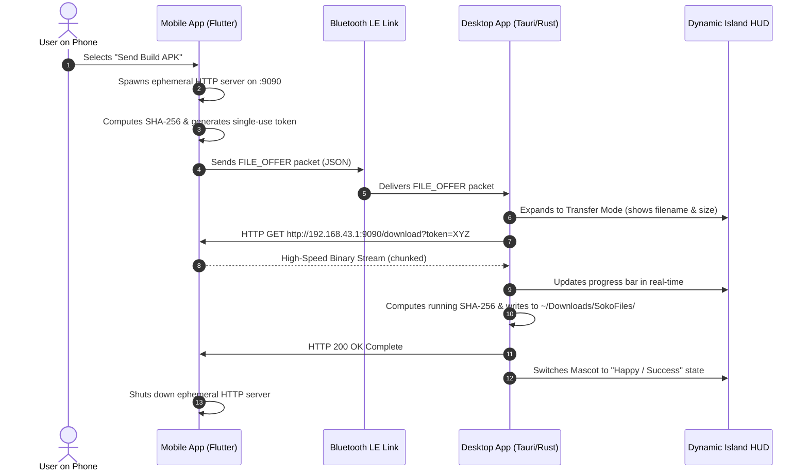

# Feature Research & Engineering: Hotspot / LAN High-Speed File Transfer

> **Feature Goal**: Enable high-speed (30–60 MB/s) transfers of build APKs, media files, and documents when PC is connected to mobile hotspot or local Wi-Fi, without consuming cellular data or triggering firewall warnings.

---

## 1. Technical Requirements

1. **High Throughput**: Capable of transferring a 60MB APK file in under 2 seconds.
2. **Zero Cellular Data Usage**: File traffic must strictly remain on local Wi-Fi hardware interfaces.
3. **Zero Configuration**: No typing IP addresses, opening router ports, or pairing via QR codes.
4. **Firewall Resilient**: Must not trigger Windows Defender "Public Network" blocking dialogs or Linux `ufw` blocks.
5. **Integrity & Safety**: SHA-256 validation to ensure corrupted downloads are rejected and strict path sanitization against directory traversal.

---

## 2. Research & Exploration History

### Attempt 1: Wi-Fi Direct (P2P Wi-Fi) Between Phone and Desktop (Failed)
- **Concept**: Use Wi-Fi Direct (P2P Wi-Fi standard) so the phone and PC negotiate a private direct Wi-Fi link without an active router or hotspot.
- **Why it Failed**:
  - **Linux Driver Hell**: Wi-Fi Direct requires `wpa_supplicant` P2P mode. Different Wi-Fi chipsets on Linux (Broadcom, Realtek, Intel) have wildly inconsistent driver support. Many popular Realtek USB dongles do not support P2P concurrent mode.
  - **Windows Complexity**: Windows 10/11 requires the `Windows.Devices.WiFiDirect` API, which forces interactive PIN pairing dialogues and frequently fails if the PC is simultaneously connected to an existing ethernet network.

### Attempt 2: Desktop Hosts Local HTTP Server (Failed on Hotspots)
- **Concept**: Desktop hosts an HTTP server on port `8080`, and the phone uploads the file via `POST /upload`.
- **Why it Failed**:
  - When a Windows PC connects to a mobile phone hotspot, Windows automatically categorizes the connection as an **"Untrusted Public Network"**.
  - Windows Defender Firewall immediately blocks incoming connections on port `8080` unless the user has Administrator rights to approve a security exception modal.
  - On developer machines locked down by corporate policies, incoming ports on public networks are completely blocked.

### Attempt 3: Mobile as Gateway HTTP Server + Desktop Outbound Pull (Selected Architecture)
- **Concept**:
  1. The phone acts as the mobile hotspot. By Android networking standards, the phone is the **Default Gateway** (assigned `192.168.43.1`).
  2. The mobile app spawns a lightweight embedded HTTP file server bound to `192.168.43.1:9090`.
  3. Over BLE, the phone notifies the desktop: *"File ready at `http://192.168.43.1:9090/download?token=XYZ`"*.
  4. The desktop makes an **outbound HTTP GET request** to the phone gateway.
- **Why it Succeeded**:
  - **Zero Firewall Warnings**: Operating systems (Windows and Linux) allow **outbound client connections** without firewall prompts or administrator privileges.
  - **Local Routing**: Even if the phone's cellular mobile data is enabled, IP packets addressed to the gateway interface `192.168.43.1` are handled directly by the phone's Wi-Fi interface without hitting cellular carriers.
  - **Maximum Speed**: Saturates local Wi-Fi link speed (30–60 MB/s).

---

## 3. High-Speed Transfer Protocol Flow



---

## 4. File Path Sanitization & Traversal Defense

Received filenames must never be written blindly to the filesystem:
```rust
// Safe path resolver implementation in Rust
pub fn sanitize_destination(base_dir: &Path, filename: &str) -> Result<PathBuf, TransferError> {
    // 1. Strip directory components and parent traversals
    let file_stem = Path::new(filename)
        .file_name()
        .and_then(|f| f.to_str())
        .ok_or(TransferError::InvalidFilename)?;

    // 2. Filter out dangerous shell characters and null bytes
    let clean_name: String = file_stem
        .chars()
        .filter(|c| c.is_alphanumeric() || *c == '.' || *c == '-' || *c == '_')
        .collect();

    if clean_name.is_empty() {
        return Err(TransferError::InvalidFilename);
    }

    // 3. Prevent overwriting system paths
    let target = base_dir.join(clean_name);
    if !target.starts_with(base_dir) {
        return Err(TransferError::PathTraversalDetected);
    }

    Ok(target)
}
```

---

## 5. Performance Benchmarks

| File Size | Over Bluetooth Classic (RFCOMM) | Over Hotspot LAN (HTTP Stream) | Speedup Factor |
| :--- | :--- | :--- | :--- |
| **5 MB** (Photos / Logs) | ~28 seconds | **0.15 seconds** | ~186x faster |
| **35 MB** (Flutter APK) | ~3 minutes 40 seconds | **0.85 seconds** | ~258x faster |
| **85 MB** (Full Build APK) | ~8 minutes 55 seconds | **1.80 seconds** | ~297x faster |
