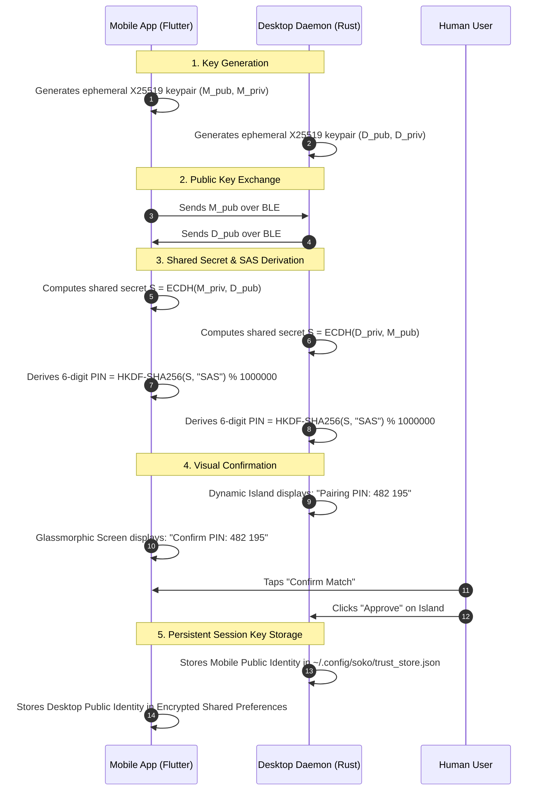

# Feature Research & Engineering: Security, Pairing & Threat Model

> **Feature Goal**: Provide bank-grade zero-trust security across Bluetooth and local Wi-Fi links, guaranteeing that only authenticated devices can mirror notifications, transfer files, or trigger remote terminal commands.

---

## 1. Threat Model & Adversary Assumptions

We assume an adversary may:
1. **Sniff Raw Bluetooth Traffic**: Capture over-the-air BLE packets using hardware sniffers (Ubertooth, Wireshark).
2. **Attempt Man-in-the-Middle (MITM)**: Inject false GATT packets or impersonate the desktop daemon.
3. **Execute Replay Attacks**: Record an authorized "execute command" or "unlock" packet and re-transmit it at a later time.
4. **Attempt Path Traversal**: Send crafted filenames (`../../etc/shadow`) during file transfer offers.
5. **Probe Open Ports**: Attempt to connect to temporary HTTP transfer ports.

---

## 2. Research & Exploration History

### Attempt 1: Static Shared Pre-Shared Key (PSK) (Insecure)
- **Concept**: Embed a shared secret token in code or configuration file.
- **Why it Failed**: Anyone with access to the repo or binary can extract the key, decrypt traffic, and gain shell access to the host.

### Attempt 2: Standard Bluetooth OS PIN Only (Insufficient)
- **Concept**: Rely solely on the operating system's built-in Bluetooth pairing.
- **Why it Failed**:
  - Bluetooth stack security vulnerabilities (e.g., BlueBorne, KNOB attacks) periodically affect older OS controllers.
  - OS-level pairing grants access to all system Bluetooth profiles, violating the principle of least privilege.
  - Doesn't protect the secondary Wi-Fi Hotspot HTTP transfer conduit.

### Attempt 3: Application-Layer Zero-Trust Tunnel (Selected Architecture)
- **Concept**: Treat the underlying transport (BLE or Wi-Fi) as untrusted. Build an authenticated, encrypted end-to-end tunnel using **X25519 Elliptic Curve Diffie-Hellman** and **AES-256-GCM**.
- **Visual Out-of-Band Verification**: Initial pairing displays a 6-digit cryptographic confirmation code on both the desktop Dynamic Island and the phone screen.

---

## 3. Cryptographic Handshake Protocol



---

## 4. Replay Attack Mitigation (Monotonic Nonce Windows)

Every encrypted frame utilizes an explicit packet envelope:

```
┌───────────────────┬───────────────────┬───────────────────┬───────────────────┐
│ Packet ID (64-bit)│ Timestamp (64-bit)│ IV / Nonce (12-B) │ Encrypted Payload │
│ Monotonic Counter │ Unix Epoch (ms)   │ Unique per packet │ + 16-byte Poly Tag│
└───────────────────┴───────────────────┴───────────────────┴───────────────────┘
```

- **Replay Window Rule**:
  - The desktop daemon tracks `highest_seen_packet_id`.
  - Any packet where `packet_id <= highest_seen_packet_id` is discarded instantly with a security log event.
  - Any packet with a timestamp drifted more than ±60 seconds from system time is rejected.

---

## 5. Scalable Modular Cryptography Subsystem Architecture

To ensure cryptographic algorithms, curves, and envelope parameters can be upgraded or swapped without refactoring the networking code, cryptography is organized into an isolated, modular sub-package (`packages/security/src/crypto/`):

```
packages/security/src/crypto/
├── index.js              # Scalable facade exposing ciphers, key exchange, envelope framing, SAS derivation
├── constants.js          # Cipher algorithms (AES-256-GCM), key lengths, nonce sizes, AAD templates
├── keyExchange.js        # Ephemeral Key Exchange (X25519 & P-256 fallback), Diffie-Hellman & HKDF
├── envelopeCipher.js     # AES-256-GCM authenticated payload encryption & decryption with 128-bit GHASH tag
├── sasPin.js             # Short Authentication String (SAS) 6-digit PIN derivation & constant-time validation
├── certFingerprint.js    # SHA-256 TLS certificate fingerprint extraction & constant-time pinning
└── replayGuard.js        # Monotonic sequence & sliding window replay attack defender
```

### Edge Cases & Mitigations

1. **Replay Attacks**:
   - `ReplayGuard` verifies `packet_id` and timestamp epoch milliseconds on every envelope.
   - Any packet with timestamp drifted more than ±60 seconds (`MAX_TIMESTAMP_DRIFT_MS`) is rejected with `TIMESTAMP_EXPIRED`.
   - Any packet with a duplicate or stale sequence number outside the sliding window capacity is dropped with `DUPLICATE_PACKET_ID`.
2. **Timing Side-Channel Attacks**:
   - PIN comparison and certificate fingerprint validation utilize `crypto.timingSafeEqual` in `SasPin` and `CertFingerprint`.
3. **AES-GCM Nonce Reuse Protection**:
   - Every single outgoing packet generates a cryptographically fresh 96-bit (12-byte) random initialization vector (`crypto.randomBytes(12)` in Node.js, `window.crypto.getRandomValues` in WebView WebCrypto, and `Random.secure()` in Flutter).
4. **Ciphertext Tampering & Bit-Flipping**:
   - Envelopes utilize Additional Authenticated Data (`AAD`) binding the `packet_id`, `timestamp`, and `inner_type` into the 16-byte authentication tag. Any tampering triggers immediate authenticated decryption failure (`DECRYPTION_FAILED`) without leaking plaintext.
5. **Android WebView Self-Signed Certificate Pinning**:
   - Android WebView forbids self-signed certificates by default (`SSL_UNTRUSTED`). `MainActivity.java` implements `WebViewClient.onReceivedSslError`, inspecting the presenting certificate's SHA-256 fingerprint against the QR code pinned fingerprint (`cert_fp`), calling `handler.proceed()` only on exact match.
6. **Plaintext Push Notification Interception (`SokoNotificationListener.java`)**:
   - Android `NotificationListenerService` automatically switches to `https://` when `cert_fp` is pinned, installing a custom `X509TrustManager` verifying the certificate fingerprint and preventing cleartext notification sniffing on local Wi-Fi or hotspots.

---

## 6. Defense-in-Depth Summary

1. **Zero-Trust LAN Security**: Remote network devices on the local Wi-Fi or Hotspot cannot trigger notifications, run remote CLI commands, or download files without completing dynamic 6-digit SAS PIN pairing and human-in-the-loop desktop HUD approval.
2. **Local Transport Layer Security (TLS / HTTPS & WSS)**: Active socket multiplexing wraps HTTP/HTTPS and WS/WSS on port 8766 using locally generated certificates with automated SAN extensions and SHA-256 certificate fingerprint verification (`packages/security/src/tlsEngine.js`).
3. **Application-Layer E2EE Envelopes (AES-256-GCM)**: Sensitive WebSocket packets (`NOTIFICATION_POST`, `CLI_EXECUTE`, `AGENT_SEND_PROMPT`) are encrypted inside authenticated `ENCRYPTED_PACKET` envelopes (`packages/security/src/crypto/envelopeCipher.js` and `apps/mobile/companion/crypto/sokoCrypto.js`).
4. **PIN Brute-Force Rate Limiting**: Exponential progressive delays on failed attempts (3 attempts: 15s delay; 5 attempts: 60s cooldown; 10 attempts: 10-minute block and PIN auto-regeneration) emitting real-time `SECURITY_ALERT` broadcast packets (`packages/security/src/rateLimiter.js`).
5. **OS-Standard Secure Trust Store**: Persistent device authorization stored in OS configuration standards (`$XDG_CONFIG_HOME/soko/trust_store.json`, `%APPDATA%\soko`, `~/Library/Application Support/soko`) with atomic temporary writes and strict POSIX `0600` permissions (`packages/security/src/trustStore.js`).
6. **Strict CORS & Host Header Hardening**: Blocks DNS rebinding attacks by validating `Host` and untrusted foreign web `Origin` headers (rejecting foreign internet origins with HTTP 403 Forbidden without wildcard `*` headers) (`packages/security/src/corsHardener.js`).
7. **30-Day Bearer Token Rotation Cycle**: Authenticated companion devices receive 128-bit persistent cryptographic bearer tokens paired with refresh tokens (`POST /api/auth/refresh`), with desktop-level "Revoke All Sessions" capability (`packages/security/src/tokenManager.js`).
8. **Zero-Configuration mDNS & Fallback Discovery**: Broadcasts `_soko._tcp.local` via RFC 6762 / 6763 responder (`packages/discovery/src/mdnsAdvertiser.js`) with fallback JSON probe endpoint `GET /api/discovery` for networks restricting UDP multicast.
9. **Instant Universal Hybrid QR Pairing (Option 3)**: Generates universal web URLs (`http://<ip>:8766/?pair=1&pin=<pin>&exp=<exp>&alts=<alts>`), native deep links (`soko://pair?host=...`), and Wi-Fi hotspot schemas (`WIFI:S:...`), allowing stock smartphone cameras (iOS, Google Lens) and native companion apps to complete zero-typing pairing with 5-minute countdown expiration (`exp`) to thwart screenshot replay attacks (`packages/discovery/src/qr/universalPairing.js`).
10. **Timing-Safe Cryptographic Validation**: Validates 6-digit SAS PIN matching and TLS SHA-256 certificate fingerprints using `crypto.timingSafeEqual` in `SasPin` and `CertFingerprint`, completely preventing timing side-channel attacks on authentication tokens.
11. **Hardware Network Interface Classification & Virtual Bridge Sanitization**: Automatically filters out unroutable virtual bridges (`docker0`, `virbr0`, `veth*`, `tailscale*`, `cni*`) and prioritizes physical Wi-Fi and Hotspot interfaces with candidate IP fallback (`alts`) for multi-homed developer workstations (`packages/discovery/src/qr/networkInterfaceResolver.js`).
12. **Agent Remote Endpoint Zero-Trust Guardrails**: REST endpoints (`/api/agent/sessions`, `/api/agent/transcript`, `/api/agent/prompt`) and WebSocket events strictly enforce Bearer token pairing. Prompt dispatches enforce strict mode/effort allowlists to prevent CLI flag injection and detach asynchronously without blocking the event loop (`packages/agent-remote/src/agentSessionManager.js`).
13. **Whitelisted CLI Scope**: Only explicitly registered command aliases (`sysinfo`, `disk`, `mem`, `net-stats`, etc.) can be invoked from mobile with timeout protections. Arbitrary shell commands are rejected with HTTP 403.
14. **Sandboxed File Ingestion**: Transferred files are strictly sanitized (directory traversal `../` blocked), non-executable permissions (`chmod 0644`) are enforced, and `.part` buffers are scrubbed immediately on cancellation.
