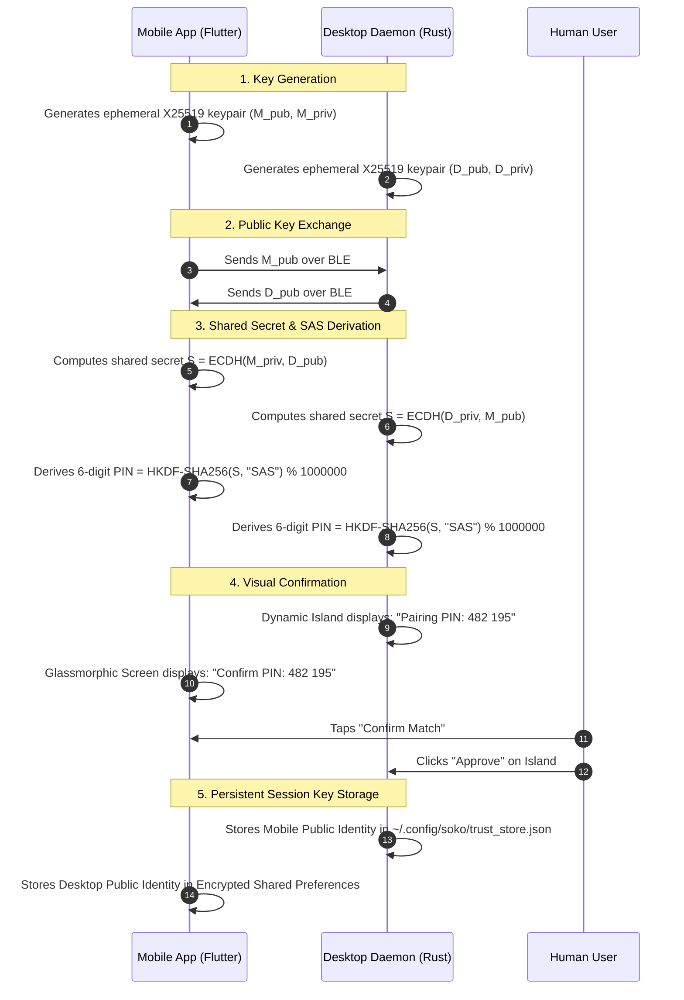

# Feature Research & Engineering: Security, Pairing & Threat Model

> **Feature Goal**: Provide bank-grade zero-trust security across Bluetooth and local Wi-Fi links, guaranteeing that only authenticated devices can mirror notifications, transfer files, or trigger remote terminal commands.

---

## 1. Threat Model & Adversary Assumptions

We assume an adversary may:
1. **Sniff Raw Bluetooth Traffic**: Capture over-the-air BLE packets using hardware sniffers (Ubertooth, Wireshark).
2. **Attempt Man-in-the-Middle (MITM)**: Inject false GATT packets or impersonate the desktop daemon.
3. **Execute Replay Attacks**: Record an authorized "execute command" or "unlock" packet and re-transmit it at a later time.
4. **Attempt Path Traversal**: Send crafted filenames (`../../etc/shadow`) during file transfer offers.
5. **Probe Open Ports**: Attempt to connect to temporary HTTP transfer ports.

---

## 2. Research & Exploration History

### Attempt 1: Static Shared Pre-Shared Key (PSK) (Insecure)
- **Concept**: Embed a shared secret token in code or configuration file.
- **Why it Failed**: Anyone with access to the repo or binary can extract the key, decrypt traffic, and gain shell access to the host.

### Attempt 2: Standard Bluetooth OS PIN Only (Insufficient)
- **Concept**: Rely solely on the operating system's built-in Bluetooth pairing.
- **Why it Failed**:
  - Bluetooth stack security vulnerabilities (e.g., BlueBorne, KNOB attacks) periodically affect older OS controllers.
  - OS-level pairing grants access to all system Bluetooth profiles, violating the principle of least privilege.
  - Doesn't protect the secondary Wi-Fi Hotspot HTTP transfer conduit.

### Attempt 3: Application-Layer Zero-Trust Tunnel (Selected Architecture)
- **Concept**: Treat the underlying transport (BLE or Wi-Fi) as untrusted. Build an authenticated, encrypted end-to-end tunnel using **X25519 Elliptic Curve Diffie-Hellman** and **AES-256-GCM**.
- **Visual Out-of-Band Verification**: Initial pairing displays a 6-digit cryptographic confirmation code on both the desktop Dynamic Island and the phone screen.

---

## 3. Cryptographic Handshake Protocol



---

## 4. Replay Attack Mitigation (Monotonic Nonce Windows)

Every encrypted frame utilizes an explicit packet envelope:

```
┌───────────────────┬───────────────────┬───────────────────┬───────────────────┐
│ Packet ID (64-bit)│ Timestamp (64-bit)│ IV / Nonce (12-B) │ Encrypted Payload │
│ Monotonic Counter │ Unix Epoch (ms)   │ Unique per packet │ + 16-byte Poly Tag│
└───────────────────┴───────────────────┴───────────────────┴───────────────────┘
```

- **Replay Window Rule**:
  - The desktop daemon tracks `highest_seen_packet_id`.
  - Any packet where `packet_id <= highest_seen_packet_id` is discarded instantly with a security log event.
  - Any packet with a timestamp drifted more than ±60 seconds from system time is rejected.

---

## 5. Defense-in-Depth Summary

1. **Memory Safety**: The desktop daemon is written in 100% safe Rust, eliminating buffer overflows, use-after-free, and memory corruption bugs.
2. **Whitelisted CLI Scope**: Only explicitly registered command aliases can be invoked from mobile.
3. **Sandboxed File Ingestion**: Files are sanitized and constrained to dedicated directories without execution bits.
4. **Biometric Step-Up Authentication**: High-privilege commands require fingerprint or face unlock before dispatch.
