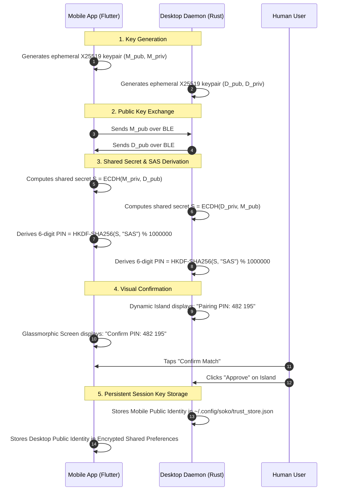

# Feature Research & Engineering: Security, Pairing & Threat Model

> **Feature Goal**: Provide bank-grade zero-trust security across Bluetooth and local Wi-Fi links, guaranteeing that only authenticated devices can mirror notifications, transfer files, or trigger remote terminal commands.

---

## 1. Threat Model & Adversary Assumptions

We assume an adversary may:
1. **Sniff Raw Bluetooth Traffic**: Capture over-the-air BLE packets using hardware sniffers (Ubertooth, Wireshark).
2. **Attempt Man-in-the-Middle (MITM)**: Inject false GATT packets or impersonate the desktop daemon.
3. **Execute Replay Attacks**: Record an authorized "execute command" or "unlock" packet and re-transmit it at a later time.
4. **Attempt Path Traversal**: Send crafted filenames (`../../etc/shadow`) during file transfer offers.
5. **Probe Open Ports**: Attempt to connect to temporary HTTP transfer ports.

---

## 2. Research & Exploration History

### Attempt 1: Static Shared Pre-Shared Key (PSK) (Insecure)
- **Concept**: Embed a shared secret token in code or configuration file.
- **Why it Failed**: Anyone with access to the repo or binary can extract the key, decrypt traffic, and gain shell access to the host.

### Attempt 2: Standard Bluetooth OS PIN Only (Insufficient)
- **Concept**: Rely solely on the operating system's built-in Bluetooth pairing.
- **Why it Failed**:
  - Bluetooth stack security vulnerabilities (e.g., BlueBorne, KNOB attacks) periodically affect older OS controllers.
  - OS-level pairing grants access to all system Bluetooth profiles, violating the principle of least privilege.
  - Doesn't protect the secondary Wi-Fi Hotspot HTTP transfer conduit.

### Attempt 3: Application-Layer Zero-Trust Tunnel (Selected Architecture)
- **Concept**: Treat the underlying transport (BLE or Wi-Fi) as untrusted. Build an authenticated, encrypted end-to-end tunnel using **X25519 Elliptic Curve Diffie-Hellman** and **AES-256-GCM**.
- **Visual Out-of-Band Verification**: Initial pairing displays a 6-digit cryptographic confirmation code on both the desktop Dynamic Island and the phone screen.

---

## 3. Cryptographic Handshake Protocol



---

## 4. Replay Attack Mitigation (Monotonic Nonce Windows)

Every encrypted frame utilizes an explicit packet envelope:

```
┌───────────────────┬───────────────────┬───────────────────┬───────────────────┐
│ Packet ID (64-bit)│ Timestamp (64-bit)│ IV / Nonce (12-B) │ Encrypted Payload │
│ Monotonic Counter │ Unix Epoch (ms)   │ Unique per packet │ + 16-byte Poly Tag│
└───────────────────┴───────────────────┴───────────────────┴───────────────────┘
```

- **Replay Window Rule**:
  - The desktop daemon tracks `highest_seen_packet_id`.
  - Any packet where `packet_id <= highest_seen_packet_id` is discarded instantly with a security log event.
  - Any packet with a timestamp drifted more than ±60 seconds from system time is rejected.

---

## 5. Defense-in-Depth Summary

1. **Zero-Trust LAN Security**: Remote network devices on the local Wi-Fi or Hotspot cannot trigger notifications, run remote CLI commands, or download files without completing dynamic 6-digit SAS PIN pairing and human-in-the-loop desktop HUD approval.
2. **Local Transport Layer Security (TLS / HTTPS & WSS)**: Active socket multiplexing wraps HTTP/HTTPS and WS/WSS on port 8766 using locally generated certificates with automated SAN extensions and SHA-256 certificate fingerprint verification (`packages/security/src/tlsEngine.js`).
3. **PIN Brute-Force Rate Limiting**: Exponential progressive delays on failed attempts (3 attempts: 15s delay; 5 attempts: 60s cooldown; 10 attempts: 10-minute block and PIN auto-regeneration) emitting real-time `SECURITY_ALERT` broadcast packets (`packages/security/src/rateLimiter.js`).
4. **OS-Standard Secure Trust Store**: Persistent device authorization stored in OS configuration standards (`$XDG_CONFIG_HOME/soko/trust_store.json`, `%APPDATA%\soko`, `~/Library/Application Support/soko`) with atomic temporary writes and strict POSIX `0600` permissions (`packages/security/src/trustStore.js`).
5. **Strict CORS & Host Header Hardening**: Blocks DNS rebinding attacks by validating `Host` and untrusted foreign web `Origin` headers (rejecting foreign internet origins with HTTP 403 Forbidden without wildcard `*` headers) (`packages/security/src/corsHardener.js`).
6. **30-Day Bearer Token Rotation Cycle**: Authenticated companion devices receive 128-bit persistent cryptographic bearer tokens paired with refresh tokens (`POST /api/auth/refresh`), with desktop-level "Revoke All Sessions" capability (`packages/security/src/tokenManager.js`).
7. **Zero-Configuration mDNS & Fallback Discovery**: Broadcasts `_soko._tcp.local` via RFC 6762 / 6763 responder (`packages/discovery/src/mdnsAdvertiser.js`) with fallback JSON probe endpoint `GET /api/discovery` for networks restricting UDP multicast.
8. **Instant QR Code Camera Pairing**: Dynamic Island Connection Popover generates ISO/IEC 18004 vector QR codes (`soko://pair?host=<ip>&port=8766&pin=<pin>`) streamed via `GET /api/discovery/qr` and scanned via HTML5 camera detector for 1-tap zero-typing handshake (`packages/discovery/src/qrGenerator.js`).
9. **Whitelisted CLI Scope**: Only explicitly registered command aliases (`sysinfo`, `disk`, `mem`, `net-stats`, etc.) can be invoked from mobile with timeout protections. Arbitrary shell commands are rejected with HTTP 403.
10. **Sandboxed File Ingestion**: Transferred files are strictly sanitized (directory traversal `../` blocked), non-executable permissions (`chmod 0644`) are enforced, and `.part` buffers are scrubbed immediately on cancellation.
