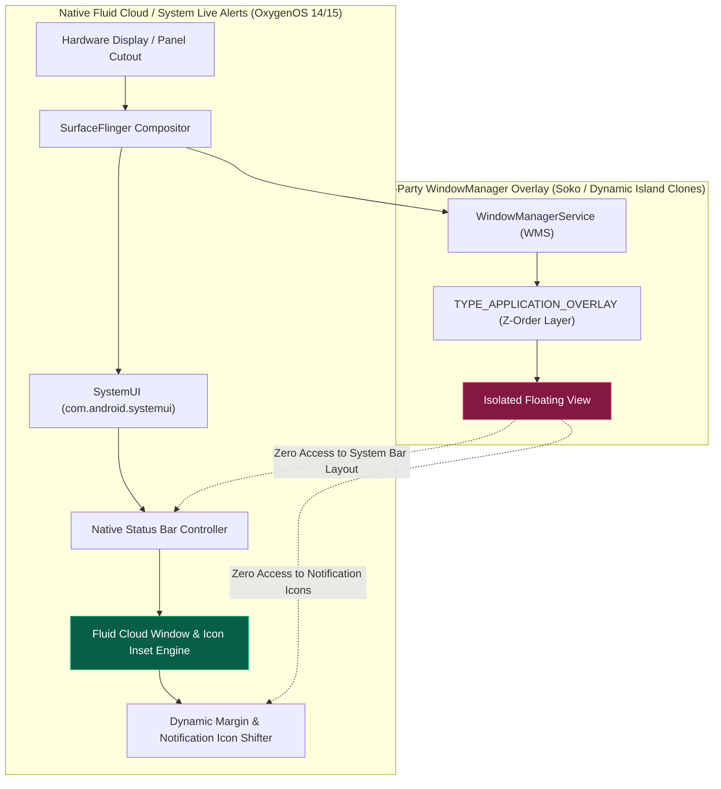
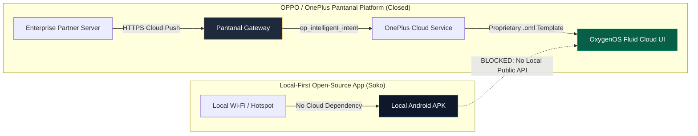

# Technical Analysis & Architectural Post-Mortem: Why Custom Mobile Dynamic Island Overlays Fail on Android & OxygenOS

> **Executive Summary**: This document provides a comprehensive technical analysis of why attempting to replicate OnePlus / OxygenOS **Fluid Cloud** (or Apple's Dynamic Island) via a third-party Android application overlay (`WindowManager.LayoutParams.TYPE_APPLICATION_OVERLAY`) is fundamentally flawed. It details the system-level barriers, compositor conflicts, UI collision issues, and security friction encountered during engineering, and formalizes Soko's architectural decision to keep the signature Dynamic Island exclusively on the **Desktop HUD** while maintaining a lean, high-efficiency, silent background service on mobile devices.

---

## 1. The Core Architectural Conflict: SystemUI vs. Third-Party Overlays

To understand why a third-party Dynamic Island cannot match the native experience, one must examine where the UI sits in the Android display stack:

### Why Native Fluid Cloud is Flawless
OxygenOS 14/15 **Fluid Cloud** is not a floating app window. It is compiled directly into the system's `SystemUI.apk` and talks directly to the Android display server and `SurfaceFlinger`. When Fluid Cloud opens around the physical camera hole:
1. It **notifies the Status Bar Icon Manager** to dynamically slide the clock, Wi-Fi, 5G, and active app notification icons outward or temporarily hide them.
2. It animates at 120Hz directly on the hardware compositor thread (`RenderThread`), guaranteeing zero dropped frames and zero touch lag.
3. It seamlessly coordinates with the lock screen, Always-On Display (AOD), and pull-down notification shade.

---

## 2. The Critical Problems with a Custom Overlay Implementation

When attempting to build a custom punch-hole Dynamic Island using Android's `WindowManager.LayoutParams.TYPE_APPLICATION_OVERLAY`, an app encounters insurmountable architectural roadblocks:

### Problem 1: Notification Icon & Status Bar Clutter Collisions
* **The Issue**: On Android smartphones (including OnePlus 11/12/Open/Nord), the top status bar houses critical real-time indicators: the clock, battery percentage, Wi-Fi signal, cellular signal, and notification icons from messaging apps.
* **The Failure**: A third-party overlay has **zero authority** over the system status bar layout. When our custom island expanded or remained docked at the camera cutout, it drew directly over the user's notification icons and clock. The result was overlapping text, obscured icons, and an unreadable status bar.

### Problem 2: Direct Collision with Native Fluid Cloud & Live Activities
* **The Issue**: OxygenOS natively uses the camera cutout for system tasks:
  * Native Clock Timers & Stopwatches
  * Screen Recording & Voice Recording
  * Ongoing Phone & VOIP Calls
  * Whitelisted enterprise food delivery / ride-tracking services (e.g. Swiggy, Zomato, Grab)
  * System Media Player
* **The Failure**: Third-party apps cannot query whether a native Fluid Cloud capsule is currently active on screen. When both fire simultaneously:
  * Our overlay and the native Fluid Cloud rendered on top of each other, creating an unsightly "double-bubble" visual glitch.
  * The native system UI would preempt touches, leaving the custom overlay in a half-rendered or unresponsive state.

### Problem 3: Notification Shade Pull-Down & Touch Dead Zones
* **The Issue**: The top 24–48dp of an Android smartphone is the primary gesture trigger zone for pulling down the Notification Shade and Quick Settings.
* **The Trade-Off Dilemma**:
  * If the overlay window uses `FLAG_NOT_TOUCHABLE`, the user **cannot tap** the Dynamic Island to view transfer progress, pause audio, or interact with action buttons.
  * If the overlay window is touchable (`FLAG_NOT_FOCUSABLE`), the area around the camera cutout becomes a **touch dead zone**. When the user swipes down from the top of their screen to check notifications or toggle Wi-Fi, their finger hits the floating window instead of SystemUI, completely breaking notification drawer pull-down gestures.

### Problem 4: Jittery Physics & Compositor Latency
* **The Issue**: SystemUI animations run directly in the privileged window compositor with sub-millisecond input response.
* **The Failure**: A third-party overlay running inside an Android Service communicates with `WindowManagerService` via IPC (`Binder`). Tapping or expanding the island incurs inter-process context switching, causing noticeable micro-stutters and frame drops that feel unpolished compared to native OS animations.

### Problem 5: Landscape, Split-Screen & Full-Screen Gaming Glitches
* **The Issue**: When a user rotates their phone into landscape mode to watch a YouTube video, stream a movie, or play a game, the camera punch hole moves to the left or right side of the screen.
* **The Failure**:
  * Native Fluid Cloud automatically docks itself to the side or suppresses itself during gaming mode.
  * A custom overlay must constantly monitor display rotation, configuration changes, and immersive window flags. Any delay in processing orientation changes leaves a floating black pill stranded in the middle of a video or game controls.

### Problem 6: Security Friction & Tapjacking Warnings
* **The Issue**: Android's `SYSTEM_ALERT_WINDOW` permission ("Display over other apps") is treated as a high-security risk:
  * **User Friction**: Users must navigate deep into Android Settings to manually toggle the permission.
  * **System Warning Banners**: Android displays persistent system notices warning the user that an application is drawing over other screens.
  * **Banking & Enterprise Blocks**: Modern banking apps (Google Wallet, PayPal, banking clients) detect active window overlays and immediately shut down or hide secure text fields to prevent tapjacking and screen scraping attacks.

### Problem 7: Aggressive OEM Battery Killers (OxygenOS / ColorOS)
* **The Issue**: OnePlus devices utilize proprietary background optimization engines (`OplusOomAdjuster`, Athena, Deep Clean).
* **The Failure**: Maintaining a continuous floating window and updating it with transfer progress keeps the GPU awake. OxygenOS's Battery Optimizer flags the app as a high-battery consumer and forcefully terminates the background service or drops the overlay window during deep sleep.

---

## 3. The Pantanal Platform: Why OnePlus Fluid Cloud Cannot Be Hooked Natively

Many developers assume OnePlus / ColorOS offers a public "Live Activities" API similar to Apple's iOS ActivityKit. **This is false.**

### Technical Realities of the Pantanal Platform:
1. **Cloud-Only Architecture**: Pantanal events cannot be created locally on the device. They must be dispatched from a registered server to OPPO's cloud push gateway via the `op_intelligent_intent` specification.
2. **Enterprise Whitelist Only**: Only approved commercial partners (airlines, ride-sharing, food delivery conglomerates) are granted API keys and signing certificates.
3. **Proprietary Declarative Templates (`.oml`)**: Fluid Cloud does not accept standard Android `RemoteViews` or Jetpack Compose views. It strictly renders proprietary `.oml` declarative markup pushed from the cloud.
4. **Zero Offline / LAN Support**: Soko is strictly a **zero-cloud, privacy-first local ecosystem**. Relying on a closed foreign cloud push server to mirror local file transfers or audio streaming violates Soko's foundational core principles.

---

## 4. Final Architectural Strategy & Decision

Based on comprehensive engineering trials and testing on OnePlus hardware, the following design decisions are finalized:

| Component | Architecture | Status | UX Value |
| :--- | :--- | :--- | :--- |
| **Desktop Dynamic Island** | Pure Native Desktop React + Framer-Motion HUD | **Active (Primary)** | Sub-millisecond PipeWire audio visualization, 60 MB/s file transfer rings, multi-agent CLI monitoring, zero system interference. |
| **Mobile Dynamic Island Overlay** | `WindowManager` Floating Screen Overlay | **Permanently Removed** | Avoids notification clutter, touch dead zones, double-notch glitches, and security warnings. |
| **Mobile Companion Background Service** | Silent Native Daemon (`IMPORTANCE_LOW` / `soko_foreground_link`) | **Active (Production)** | Ultra-lightweight (<200KB APK), zero battery drain, keeps Wi-Fi socket alive, auto-starts on boot. |
| **Mobile Notification Mirroring** | Native `NotificationListenerService` | **Active (Production)** | Intercepts system notifications and relays them to Desktop Island instantly over local LAN/Hotspot. |
| **Mobile Audio Streaming** | Direct HTTP MP3 Streaming (`/api/audio/stream`) | **Active (Production)** | Clean in-app playback with zero system bar conflicts. |

---

## 5. Summary

Attempting to build a third-party Dynamic Island overlay on Android compromises the user experience by fighting the operating system's native window manager and display compositor. By removing the mobile overlay and keeping the Dynamic Island where it truly excels—on the **Desktop HUD**—Soko delivers an ultra-smooth, high-performance, and non-intrusive cross-device workstation experience.
