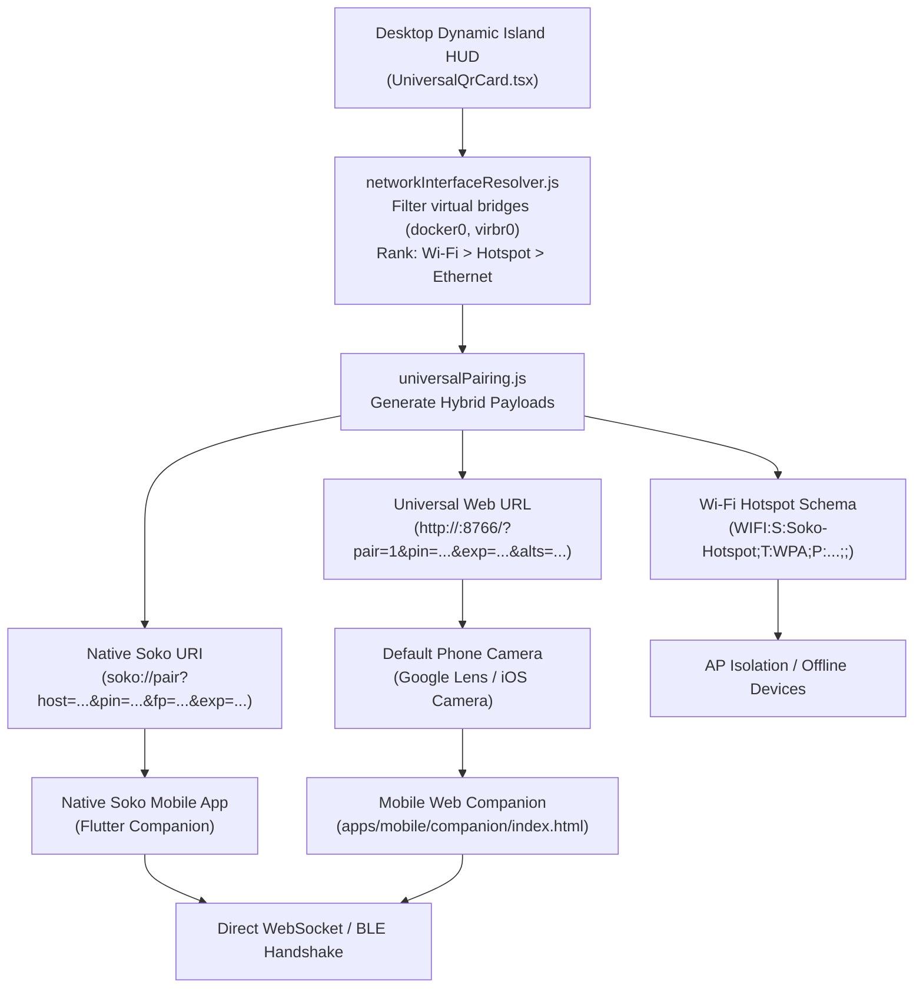

# Universal QR Pairing & Multi-Interface Fallback Engine

## Overview

The **Universal QR Pairing Engine** implements a **Zero-Configuration Hybrid Architecture (Option 3)** for pairing desktop workstations running the Soko Dynamic Island HUD with mobile companion clients.

Prior pairing workflows required either manual IP entry or a dedicated native mobile scanner. Soko's Universal Hybrid model bridges standard smartphone camera apps (iOS Camera, Android Google Lens, Samsung Camera), native deep links, and isolated Wi-Fi hotspots into a unified QR code.

---

## ⚡ Core Architecture



---

## 🔑 Key Features

### 1. Default Phone Camera Compatibility (Universal Web URL)
When scanned with any stock smartphone camera:
- Directly navigates to `http://<desktop-ip>:8766/?pair=1&pin=<sasPin>&exp=<timestamp>&alts=<candidateIps>`
- Launches the lightweight Web Companion instantly in mobile Chrome/Safari.
- Automatically populates the 6-digit SAS pairing PIN and desktop IP into the connection manager.
- If the native Soko Android app is installed, prompts a 1-tap deep link launch (`soko://pair?...`).

### 2. Multi-Interface Intelligence & Virtual Bridge Filtering
Workstations frequently run Docker, Podman, libvirt, WSL, or VPN tunnels, creating virtual network adapters with unreachable subnets.
- **Virtual Bridge Filtering**: `networkInterfaceResolver.js` automatically detects and filters out `docker0`, `br-*`, `virbr*`, `veth*`, `vnet*`, `vmnet*`, `tailscale*`, `tun*`, `tap*`, `wg*`, and `cni*`.
- **Affinity Prioritization**:
  1. Physical Wi-Fi (`wlan*`, `wl*`) — Highest affinity with mobile phones on the same WLAN.
  2. Mobile Hotspot / AP interfaces (`*ap*`, `*hotspot*`).
  3. Physical Ethernet (`eth*`, `en*`).
- **Alternative Candidate IP Fallback (`alts`)**: If a multi-homed desktop has both Wi-Fi and Ethernet active, alternative candidate IPs are encoded into the QR parameters (`alts=192.168.1.50,10.0.0.12`). If the primary IP is unreachable from the phone's routing table, the companion's `probeReachableHost` automatically probes alternative candidates.

### 3. Time-Sensitive Expiration & Replay Defense
- Every generated QR payload includes a Unix timestamp expiration (`exp`), configured with a **5-minute Time-To-Live (300 seconds)** by default.
- Dynamic Island HUD displays a live countdown clock (`Clock` icon, e.g. `4:42`) and automatically refreshes the SAS PIN when expired.
- Prevents shoulder-surfing and screenshot replay attacks: scanning an expired QR code immediately triggers a warning banner and prompts the user to refresh the desktop HUD.

### 4. Zero-Trust Cryptographic Pinning & Timing-Safe Verification
- **Certificate Pinning**: QR codes encode the desktop's active TLS SHA-256 certificate fingerprint (`fp`). Mobile clients verify the server's certificate against this fingerprint to prevent Man-in-the-Middle (MitM) attacks.
- **Constant-Time Verification**: Server-side PIN verification and fingerprint validation use `crypto.timingSafeEqual` in `qrSecurityValidator.js` to eliminate timing side-channel attacks.
- **Sanitization**: Workstation names, host parameters, and Wi-Fi credentials undergo strict character filtering and RFC escaping (`escapeWifiString`).

---

## 🛠️ Module Structure

| Path | Purpose |
| :--- | :--- |
| `packages/discovery/src/qr/universalPairing.js` | Universal QR payload builder and multi-format parser |
| `packages/discovery/src/qr/networkInterfaceResolver.js` | Hardware network interface classifier & virtual bridge filter |
| `packages/discovery/src/qr/qrSecurityValidator.js` | Zero-Trust expiration, pinning, and timing-safe validator |
| `apps/desktop/src/components/island/pairing/UniversalQrCard.tsx` | Dynamic Island 3-tab pairing card (Phone Cam, Soko App, Hotspot) |
| `apps/mobile/companion/qr/universalScanner.js` | Dual-engine client scanner (BarcodeDetector + jsQR fallback) |
| `apps/mobile/lib/services/pairing/universal_qr_parser.dart` | Flutter native QR parsing library |
| `tests/test_universal_qr.js` | 16-suite unit and integration test suite |

---

## 🧪 Testing

Run the dedicated universal QR test suite:
```bash
npm run test:qr
```
Tests verify interface classification, virtual bridge exclusion, universal URL construction, multi-format parsing, expiration checking, timing attack resistance, and companion scanner resilience.
