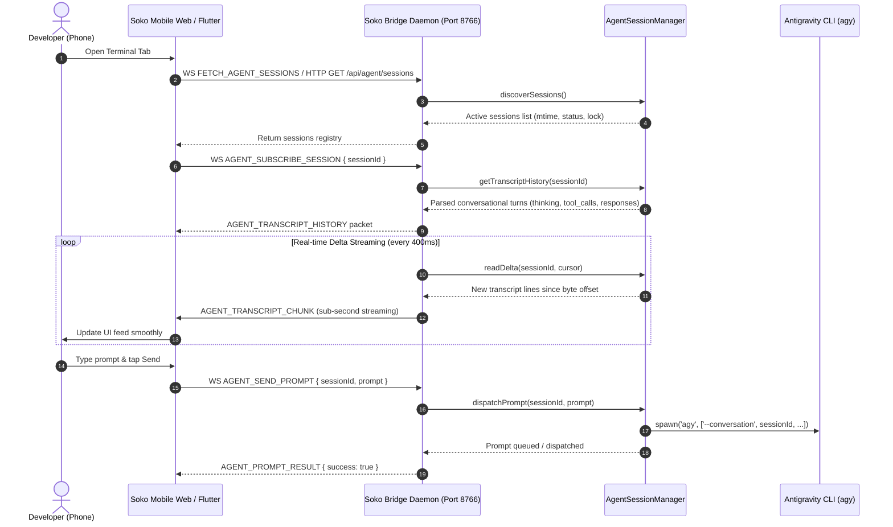

# Real-Time Mobile Agent Terminal & Transcript Streaming

## Overview

The **Soko Agent Remote & Transcript Streaming Subsystem** connects the desktop developer AI agent (Google Antigravity CLI `agy`, Claude Code, Codex) directly to the mobile companion app. Developers can monitor long-running background tasks, read agent thought processes, inspect executed shell commands and file diffs, and dispatch prompt instructions straight from their phone.

---

## ⚡ Architecture & Event Pipeline



---

## 🔑 Key Features

### 1. Zero-Polling Real-Time Delta Streaming
- Instead of re-reading entire multi-megabyte transcript files over HTTP, `AgentSessionManager` maintains a **byte offset cursor** (`activeSessionCursors`).
- Every 400ms, newly appended JSONL lines are read from disk (`readDelta`) and broadcast over WebSockets as `AGENT_TRANSCRIPT_CHUNK` packets.
- Provides true sub-second streaming response times with zero network overhead.

### 2. Conversational Turn Decomposition & Mobile Ergonomics
Raw agent transcripts contain internal system tags, identity instructions, and large multi-thousand-line shell outputs. Soko parses and structures this telemetry into clean, human-readable mobile components:
- **Clean User Prompt Bubbles**: Strips internal XML blocks (`<USER_REQUEST>`, `<ADDITIONAL_METADATA>`, `<user_rules>`, `<identity>`) to display only clean, user-authored prompts.
- **Collapsible Thought Accordion**: Agent internal reasoning (`item.thinking`) is rendered inside a minimal amber disclosure widget (`[Show ▾] / [Hide ▴]`), keeping the viewport uncluttered.
- **Unified Tool Call Pill**: Replaces verbose JSON tool payloads with concise action summaries (e.g. `$ git status`, `Edit ConnectionPopover.tsx`).
- **Tool Output Capping**: Shell commands producing thousands of lines of logs (e.g. `npm test`) are automatically capped to 40 lines / 4KB with a friendly truncation notice, preventing mobile browser memory freezes.

### 3. Remote Prompt Turn Dispatching with Execution Guardrails
- **Instantaneous Optimistic Feedback**: Typing a prompt and pressing Send immediately inserts an optimistic turn into the mobile feed.
- **Strict Mode & Effort Allowlists**: Prevents CLI argument injection attacks by enforcing strict allowlists (`mode`: `auto`, `interactive`, `plan`, `code`; `effort`: `low`, `medium`, `high`, `max`).
- **Queueing Guardrails**: If an active turn is currently running, subsequent prompts are safely queued to prevent session state corruption.
- **Zero-Hang Process Detachment**: Child processes running in the background are detached via `child.unref()`, preventing Node.js event-loop deadlocks.

### 4. Zero-Trust Access Control
- All Agent Remote REST endpoints (`/api/agent/sessions`, `/api/agent/transcript`, `/api/agent/prompt`) and WebSocket packet types (`AGENT_SEND_PROMPT`, `AGENT_SUBSCRIBE_SESSION`) strictly require **paired Bearer token authentication**.
- Unauthenticated or expired requests from remote networks are immediately blocked with HTTP 401 Unauthorized.

---

## 🛠️ Module Structure

| Path | Purpose |
| :--- | :--- |
| `packages/agent-remote/src/agentSessionManager.js` | Brain directory discovery, delta streaming, and `agy` process manager |
| `packages/agent-remote/src/index.js` | Package exports and sanitization helpers |
| `apps/mobile/companion/agent-terminal/terminal.js` | Companion Web Terminal engine, optimistic turns, and markdown parser |
| `apps/mobile/companion/agent-terminal/terminal.css` | Glassmorphic mobile terminal styles and responsive touch targets |
| `apps/mobile/lib/features/agent_terminal/` | Native Flutter companion view, models, and service |
| `tests/test_agent_remote_integration.js` | Comprehensive HTTP and WebSocket streaming integration tests |

---

## 🧪 Testing

Run the agent remote test suite:
```bash
npm run test:agent
```
Verifies ANSI sequence cleaning, tool output capping, session discovery, path traversal guardrails, delta tailing, REST API authorization, and live WebSocket telemetry ingestion.
