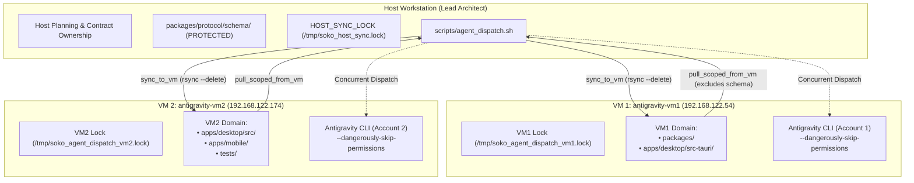

# Feature Research & Engineering: Multi-Agent KVM Fleet Orchestration & Hardened Dispatcher

> **Feature Goal**: Distribute monorepo development tasks concurrently across dedicated KVM guest worker nodes running independent Google Antigravity instances while maintaining strict Host architectural control, deterministic contract ownership, and transport-level blast radius isolation.

---

## 1. Overview & Architectural Motivation

Building a complex zero-cloud ecosystem like **Soko**—spanning desktop Electron/Tauri/Rust, mobile Flutter/Android, protocol schemas, and cryptographic subsystems—imposes heavy cognitive load and high compilation demands. 

The **Soko Multi-Agent Orchestration Protocol** leverages a 3-node topology:
1. **Host Workstation (Lead Architect / Orchestrator)**: Owns root configuration, data contracts (`packages/protocol/schema/`), Tauri IPC definitions, release merges, and high-level architectural planning.
2. **VM 1 (`antigravity-vm1`, `192.168.122.54`)**: Dedicated KVM worker executing backend logic, Rust systems (`packages/`, `apps/desktop/src-tauri`), encryption, and low-level packet protocols.
3. **VM 2 (`antigravity-vm2`, `192.168.122.174`)**: Dedicated KVM worker executing Dynamic Island frontend UI (`apps/desktop/src/`), Flutter mobile companion (`apps/mobile/`), and end-to-end QA tests (`tests/`).



---

## 2. Key Hardened Subsystems & Mechanisms

### 2.1 Dual-Tier Concurrency & Disk Sync Locks

Earlier dispatcher implementations used a single global lock file (`/tmp/soko_agent_dispatch.lock`), which serialized all agent tasks and made concurrent multi-VM execution impossible.

The hardened architecture employs **two decoupled locking tiers**:
1. **Target-Specific Execution Locks (`/tmp/soko_agent_dispatch_${target}.lock`)**:
   - `vm1` acquires File Descriptor `8` on `/tmp/soko_agent_dispatch_vm1.lock`.
   - `vm2` acquires File Descriptor `9` on `/tmp/soko_agent_dispatch_vm2.lock`.
   - Operations targeting `all` acquire both locks.
   - Result: VM 1 can execute a 30-minute Rust task simultaneously while VM 2 executes a 15-minute Flutter task.
2. **Short-Lived Host Tree Sync Lock (`/tmp/soko_host_sync.lock`)**:
   - Pushes (`sync_to_vm`) and pulls (`pull_scoped_from_vm`) acquire File Descriptor `7` using `flock -w 60` only for the brief duration of disk rsync operations.
   - Prevents race conditions and I/O thrashing on the Host storage volume while allowing long-running tasks to compute concurrently.

### 2.2 Transport-Layer Scoping & Blast Radius Isolation

Rather than relying on LLM prompt obedience to restrict modified files, boundaries are enforced at the network transport layer via `rsync`:

- **VM 1 Pull Scope**: Only synchronizes `packages/` and `apps/desktop/src-tauri/`.
- **VM 2 Pull Scope**: Only synchronizes `apps/desktop/src/`, `apps/mobile/`, and `tests/`.
- Even if an agent accidentally mutates files outside its domain on the guest filesystem, those changes are never transferred back to the Host.

### 2.3 Host Canonical Schema Protection (`HOST_PROTECTED_EXCLUDES`)

Rule 5 of the protocol dictates that `packages/protocol/schema/` is owned exclusively by the Host. Because VM 1's owned paths include all of `packages/`, a scoped pull could inadvertently overwrite Host schemas with outdated or worker-modified definitions.

To eliminate this vulnerability:
```bash
HOST_PROTECTED_EXCLUDES=(
    --exclude '/protocol/schema/'
    --exclude 'packages/protocol/schema/'
)
```
These exclusion flags are passed into `rsync -az --delete` inside `pull_scoped_from_vm()`. As a result:
- Host canonical schemas are **never overwritten** by VM 1.
- Existing Host schemas are **never deleted** during `--delete` reconciliations.

### 2.4 Remote Timeout Enforcement & Zombie Process Cleanup

Applying timeouts on the Host `ssh` client process severs the SSH connection upon timeout, but leaves the remote `agy` process running on the guest VM as an orphaned zombie.

The hardened dispatcher solves this through remote guest-side lifecycle management:
1. **Guest-Side Kernel Timeout**: Commands execute wrapped in `timeout --kill-after=10s ${timeout_secs}` inside the VM, ensuring the guest OS terminates the process group upon expiration.
2. **Post-Failure SSH Process Sweeper**: If the remote command returns non-zero (`rc != 0` or `rc == 124`), the dispatcher sends a guaranteed cleanup probe:
   ```bash
   ssh -o BatchMode=yes -o StrictHostKeyChecking=no "${VM_USER}@${ip}" \
       "pkill -f 'agy --mode' || true" >/dev/null 2>&1 || true
   ```
   This prevents lingering background agents from mutating guest files during subsequent tasks.

### 2.5 Clean Workspace Syncing (`--delete` with Exclusions)

When a task fails or times out, untracked temporary files left behind on the VM could be pulled into the Host by a subsequent successful task.

`sync_to_vm()` resolves this by pushing snapshots with `rsync -az --delete`:
- Untracked stray files on the guest VM are automatically expunged before each task run.
- Build caches and secret keys are preserved via `RSYNC_EXCLUDES` (`target/`, `node_modules/`, `.dart_tool/`, `.gradle/`, `build/`, `.env*`, `*.keystore`). Standard `rsync --delete` will not touch excluded directories.

### 2.6 Targeted Infrastructure vs Task Failure Fallback

- **Infrastructure Fallback (VM Offline / Unreachable)**: If `start_vm_if_offline` fails to boot the VM via `virsh` after 40 seconds, the dispatcher automatically executes the prompt locally on the Host workstation (preserving safety prompts without `--dangerously-skip-permissions`).
- **Task Failure / Timeout (VM Online)**: If the remote agent times out or fails a compilation gate, the dispatcher **does not blindly re-run the prompt on the Host**. Instead, it leaves the Host working tree clean, tees the full transcript to `logs/runs/<timestamp>_<vm>.log`, and returns the non-zero exit code to the Host Orchestrator for prompt refinement or debugging.

### 2.7 Automated Dependency Auditing & Per-Run Logs

1. **Dependency Manifest Diff Detection**: Upon successful pull, `pull_scoped_from_vm` executes an automated git manifest check:
   ```bash
   git -C "$PROJECT_DIR" diff --stat -- \
       '*/Cargo.toml' '*/package.json' '*/pubspec.yaml' \
       'Cargo.toml' 'package.json' 'pubspec.yaml'
   ```
   Any added or modified dependencies are printed immediately to standard output for architectural review.
2. **Per-Run Log Archival**: Remote outputs stream live to the terminal while being archived to timestamped logs (`logs/runs/${timestamp}_${target}.log`).

---

## 3. Command Reference

The dispatcher script is located at [`scripts/agent_dispatch.sh`](file:///home/saurabh/coding/soko/scripts/agent_dispatch.sh).

```bash
# Check fleet status (libvirt state, SSH reachability, agy CLI responsiveness)
./scripts/agent_dispatch.sh status

# Boot VM guests and verify agy CLI initialization
./scripts/agent_dispatch.sh start [vm1|vm2|all]

# Cleanly shut down VM guests via ACPI
./scripts/agent_dispatch.sh stop [vm1|vm2|all]

# Push clean Host workspace snapshot to VM guests
./scripts/agent_dispatch.sh sync [vm1|vm2|all]

# Pull domain-scoped changes from VM guests to Host
./scripts/agent_dispatch.sh pull <vm1|vm2|all>

# Execute an autonomous task on a VM worker
./scripts/agent_dispatch.sh run <vm1|vm2> "<prompt>" [mode] [effort] [timeout_secs]
```

---

## 4. Standard Task Specification Template

When dispatching prompts to VM workers, adhere to the structured template defined in [`AGENTS.md`](file:///home/saurabh/coding/soko/AGENTS.md):

```text
Goal: <Specific objective and context>
Allowed Paths: <Exact directory or file list the agent is permitted to touch>
Forbidden Paths: <Explicit out-of-bounds files>
Contracts: <Signatures, schema files, or interfaces to adhere to>
Acceptance Commands: <Exact commands that must pass before reporting done>
Deliverable Report: <List files changed, verification output, and any blockers>
```

---

## 5. Domain Ownership & Acceptance Gates Matrix

| Domain | Primary Node | Transport Owned Paths | Verification Acceptance Gate |
| :--- | :--- | :--- | :--- |
| **Rust & Backend Systems** | **VM 1** (`.54`) | `packages/`, `apps/desktop/src-tauri/` | `cargo fmt --check && cargo clippy -- -D warnings && cargo test` (in `apps/desktop/src-tauri`) |
| **Frontend & UI** | **VM 2** (`.174`) | `apps/desktop/src/` | `npm run build` (in `apps/desktop`) && `npm test` (root) |
| **Mobile Companion** | **VM 2** (`.174`) | `apps/mobile/` | `flutter analyze && flutter test` (in `apps/mobile`) |
| **End-to-End Test Suite** | **VM 2** (`.174`) | `tests/` | `npm test` / `npm run test:all` |
| **Core Contracts & Release** | **Host** (`.1`) | `packages/protocol/schema/`, root configs | `npm run test:all` |
